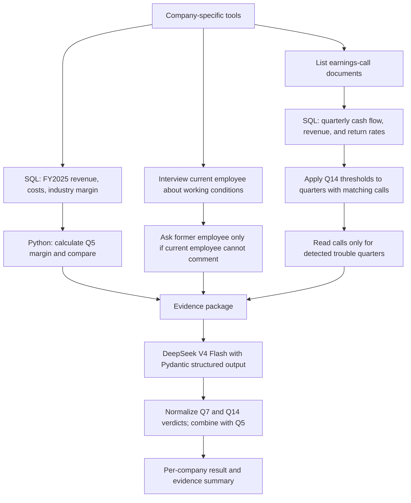

# FTEC5660 Homework 3: Fisher's 15-Point Investment Agent

Build a LangChain agent that researches a company with tools and applies the
framework from Philip Fisher's *Common Stocks and Uncommon Profits* (Part One,
Chapter 3 "What to buy: the fifteen points to look for in a common stock", and
Chapter 4 "What to buy: applying this to your own needs"). You choose 3 of
Fisher's 15 points and decide yourself what PASS means for each. For every
company your agent gives a PASS/FAIL verdict on your 3 points and a short
summary.

The companies are fictional, so the model cannot answer from memory. Unlike a
pile of reports, the evidence is spread over three sources, and your agent has
to go and get it with tools, the way Fisher's "scuttlebutt" method sends an
investor to talk to customers, competitors, suppliers and staff.

## Data and tools

`public_test/` has one folder per company. Your code receives four tools per
company (built by the provided code in `hw3.py`):

| Tool | What it gives you |
| --- | --- |
| `list_documents()` | the company's six documents and their dates |
| `read_document(name)` | one document: the 2025 letter to shareholders, four earnings calls (Q3 2025 to Q2 2026) and a news file (July 2025 to July 2026) |
| `sql_query(query)` | one read-only SQLite query on the company's database; at most 50 rows come back, so use `SUM`, `GROUP BY` and `WHERE` |
| `interview(role, topic)` | what one person says about the company; at most **10 interviews per company** |

The documents are what management says. Management's own claims (such as "we
have never cut research" or "our people are our greatest strength") are not
evidence on their own: check them against the database and the interviews.

**Database tables** (amounts in USD thousands; dates `YYYY-MM-DD`, months
`YYYY-MM`, quarters like `2025Q3`; the fiscal year is the calendar year):

| Table | Columns |
| --- | --- |
| `company` | name, industry |
| `industry_medians` | industry, revenue_growth_2y_pct, new_product_share_pct, new_product_sales_per_rd, operating_margin_pct (one row per industry; use the row for the company's own industry) |
| `orders` | order_id, order_date, product, customer, amount, note (about 3,000 to 4,000 orders from January 2023 to June 2026; revenue is the sum of order amounts) |
| `products` | product, launch_date |
| `monthly_costs` | month, cost_of_sales, selling_admin, research_development |
| `quarterly_cash` | quarter, operating_cash_flow, capex, cash_end |
| `capex_plan` | year, planned_capex (2026 to 2028) |
| `returns` | month, units_shipped, units_returned |
| `insider_trades` | trade_date, person, title, side (`buy` or `sell`), shares, price |

**Terms used in the data.**

| Term | Meaning |
| --- | --- |
| FY2025 | Fiscal year 2025. Here the fiscal year is the calendar year, so FY2025 is January to December 2025. |
| Quarter | Three months of the year: Q1 is January to March, Q2 April to June, Q3 July to September and Q4 October to December. The database writes `2025Q3`; the documents write "third quarter 2025". |
| Amounts | The database is in **USD thousands** (676,100 means US$676.1 million). The documents use USD millions. |
| Revenue | Money from sales: the sum of `amount` in `orders`. |
| Cost of sales | The cost of making the products that were sold. |
| Selling and admin | The cost of selling and of running the company (sales staff, offices, management). |
| R&D | Research and development spending, mainly on new products. |
| Operating margin | Operating profit as a share of revenue: (revenue − cost of sales − selling and admin − R&D) ÷ revenue. |
| Operating cash flow | Cash that the day-to-day business brings in during a quarter. |
| Cash at the end of a quarter | The cash the company holds on the last day of that quarter (`cash_end`). |
| Capex | Capital expenditure: spending on factories, machines and other long-term assets. `capex_plan` holds the planned capex for 2026 to 2028. |
| Return rate | Units returned ÷ units shipped, from the `returns` table. |
| Industry median | The middle value for companies in the same industry, from `industry_medians`. |
| Insider | A director or senior manager of the company. `insider_trades` lists the shares they bought (`buy`) or sold (`sell`). |
| Earnings call | A meeting each quarter where management presents the quarter's results to investors. Each call quotes that quarter's revenue. |

**Interviews.** Roles: `customer`, `current_employee`, `former_employee`,
`competitor`, `supplier`. Topics: `sales_team`, `working_conditions`,
`top_management`, `decision_making`, `competitive_edge`. Only some people know
about each topic; the others say they can't comment, and that answer still
uses up one interview.

| Topic | Who knows about it |
| --- | --- |
| `sales_team` | customer, competitor |
| `working_conditions` | current_employee, former_employee |
| `top_management` | former_employee, supplier |
| `decision_making` | supplier, customer |
| `competitive_edge` | competitor, customer |

People who know about a topic always agree with each other, so one good answer
is enough.

## Choose your 3 points and your rules

Pick any 3 of Fisher's 15 points and write them in `CHOSEN_POINTS` near the
top of `hw3.py`, e.g. `CHOSEN_POINTS = [1, 7, 15]`. The full questions are in
`FISHER_POINTS` in `hw3.py` and in the book.

| # | Fisher's point | Where the evidence is |
| --- | --- | --- |
| 1 | Market potential for sales growth | database |
| 2 | New products as current lines mature | database |
| 3 | Effective research and development | database |
| 4 | Above-average sales organization | interviews (`sales_team`) |
| 5 | Worthwhile profit margin | database |
| 6 | Maintaining or improving margins | database |
| 7 | Labour and personnel relations | interviews (`working_conditions`) |
| 8 | Executive relations | interviews (`top_management`) |
| 9 | Depth of management | interviews (`decision_making`) |
| 10 | Cost analysis and accounting controls | earnings calls, checked against the database |
| 11 | Advantage over competitors | interviews (`competitive_edge`) |
| 12 | Long-range outlook on profits | database |
| 13 | Growth without dilutive equity financing | database |
| 14 | Management talks freely about troubles | earnings calls, checked against the database |
| 15 | Management of unquestionable integrity | news file, checked against the database |

For each of your points, **you design the rule**: which evidence to use, what
to compute or whom to ask, and where the line between PASS and FAIL lies. PASS
means the company looks favourable on that point, as Fisher would see it.

We grade your verdicts against our own answer key. It uses one fixed rule per
point, which we do not publish, and the data never puts a company close to
the line of that rule, so a sensible reading of Fisher usually gives the same
answer. **Test your rules on the public answers**:
`public_test/ground_truth.json` gives the expected verdict on all 15 points
for each of the 20 public companies, and every point fails in 6 of them. If
your rule disagrees with the public answers, rethink it.

**Tip: calculate with tools, not in your head.** Do every sum, ratio and
comparison in SQL or Python, including the number of days between two dates
(SQLite's `julianday()` gives a date as a number of days).

## Student task

Fill in the three places in `hw3.py` marked `### YOUR CODE HERE`. You may add
imports, constants and helper functions above them, but do not change the
provided code below them:

- `CHOSEN_POINTS` lists your 3 points.
- `build_agent()` creates your model and anything else you need once.
- `analyze_companies(agent, companies)` receives
  `{company_folder: [list_documents, read_document, sql_query, interview]}`
  and returns, for every company,
  `{"points": {1: "PASS", 7: "FAIL", 15: "PASS"}, "summary": "..."}` (here with
  `CHOSEN_POINTS = [1, 7, 15]`).

Use the course techniques that fit your points: tool use for the database and
the interviews, planning which interviews to spend, routing each point to the
right source, prompt chaining, parallel calls, reflection to check your
answers, or a combination. Your code must read company data **only through
the four tools**; do not open `company.db` or `interviews.dat` yourself. Do
not hard-code folder names, company names or the public answers.

## Setup and public test

```bash
python3 -m venv .venv
source .venv/bin/activate
pip install -r requirements.txt
echo "DEEPSEEK_API_KEY=your_key_here" > .env
python3 hw3.py --data-folder public_test
```

Use your own DeepSeek API key (from https://platform.deepseek.com). The
required model is `deepseek-v4-flash`. We grade with our own key, so never put
a key in your code; `.env` must stay out of git.

The program creates `results.csv` with the columns `company`, `points`,
`points_correct`, `point_errors`, `interviews_used` and `summary`, and prints
the point score on your 3 points (the percentage after "balanced"). The point
score is the average of two shares: the share of truly passing verdicts that
you marked PASS and the share of truly failing verdicts that you marked FAIL.
For example, 90% and 60% give (90% + 60%) / 2 = 75%, and marking every point
PASS gives (100% + 0%) / 2 = 50%. Once `CHOSEN_POINTS` is set, the starter
runs before you add any API code (it returns no verdicts, so it scores 0%).

`public_test/ground_truth.json` gives the expected verdicts on all 15 points
for each public company. Grading uses a private set of about 20 unseen
companies with the same tools and the same answer key rules, but different
names and wording, and scores your 3 points only.

## Homework 3 solution:

### My 3 points and rules

I selected Fisher's points 5, 7, and 14. Profitability is one of the most
important signs of whether a business is being run successfully, which makes
point 5 a useful starting point. Points 7 and 14 examine two complementary
parts of a company's internal health: employee relations and management's
willingness to discuss problems. Both can inform an assessment of the
company's ability to develop over the long term. I also wanted to learn more
than how to issue database queries. Points 7 and 14 require an AI model to
interpret qualitative evidence and compare management's statements with
quantitative evidence, while point 5 provides a clear calculation to check.

#### Point 5: Worthwhile Profit Margin

I chose this point because profitability is a basic indicator of whether a
company can operate successfully. Comparing its margin with its industry
peers gives the result useful context.

**PASS rule:** Calculate FY2025 operating margin as `(revenue - cost of sales -
selling and administrative expenses - R&D expenses) / revenue`. PASS if the
result is greater than or equal to the company's industry median; otherwise
FAIL.

**Evidence:** Use `sql_query` on `orders` and `monthly_costs` for the FY2025
amounts and `company`/`industry_medians` for the company's industry benchmark.
Python performs the arithmetic.

#### Point 7: Labor and Personnel Relations

I chose this point because employees' experiences can reveal workplace
conditions and morale that financial statements do not show. These conditions
may affect a company's ability to retain and develop people over time.

**PASS rule:** Ask a current employee about `working_conditions`; if that
person cannot comment, ask a former employee. PASS only when the response
clearly supports outstanding relations, such as fair treatment, retention,
and responsive problem-solving. FAIL when it describes serious problems or is
inconclusive. A single interview is qualitative evidence and is not treated as
a representative employee survey.

**Evidence:** Use the `interview` tool with `current_employee` and
`working_conditions`, with `former_employee` as a fallback when needed. The
model classifies the supplied answer as POSITIVE, NEGATIVE, or UNCLEAR.

#### Point 14: Management Discusses Trouble Freely

I chose this point because it combines management candor with operational
evidence. It tests whether management addresses problems that can be
independently identified in company data.

**PASS rule:** Evaluate only quarters with a matching earnings call. A
negative quarterly operating cash flow is a material difficulty. A positive
operating cash-flow margin is material only when it is at least 2 percentage
points below its own mean across the five preceding quarters in two
consecutive quarters with calls. A return rate is material when it exceeds
its mean over the five preceding quarters by more than 2 population standard
deviations and is at
least one percentage point above that mean. PASS if management clearly
acknowledges and addresses each detected difficulty, or if none is detected;
FAIL if management omits, evades, or materially contradicts a detected
difficulty. The
five-quarter histories are baselines only and are not themselves disclosure
events.

**Evidence:** Use `sql_query` on `quarterly_cash`, `orders`, and `returns` to
calculate the financial and return-rate measures. Use `list_documents` to
identify earnings-call quarters and `read_document` to inspect the matching
call for each detected difficulty. The model assesses the management response
against the calculated evidence.

#### Q14 Rule Refinement and Public-Test Results

The Q14 rule was refined through several public-test iterations. Under the
initial rule, the first run produced only **21/60 correct verdicts (29.8%
balanced accuracy)**. The main problem was that the screen was too sensitive to
isolated statistical abnormalities. It could treat a single positive cash-flow
decline as a major operating difficulty, and it did not cleanly separate the
five-quarter baseline from the quarters for which management actually had an
earnings call. As a result, some companies were marked as disclosure failures
even when the call had already explained a return-rate problem.

I then tightened the rule in two ways. First, only quarters with a matching
earnings call became Q14 disclosure tests; earlier quarters were retained only
to calculate the five-quarter baseline. Second, a positive operating-cash-flow
decline had to occur in two consecutive call-covered quarters before it counted
as a material difficulty. Negative operating cash flow still triggered an
immediate review, while return-rate deterioration required both a two-standard-
deviation outlier and at least a one-percentage-point increase over the
historical mean. This improved the public-test result to **45/60 correct
verdicts (77.4% balanced accuracy)** and reduced false positives caused by
ordinary or isolated fluctuations.

The remaining model calls initially failed because DeepSeek's thinking mode did
not support the `tool_choice` parameter required by LangChain's structured
function-calling output. The API returned a 400 error before the model could
produce the Q7 and Q14 structured assessments, so those attempts used the
program's per-company fallback values and could not improve the score. I
disabled thinking mode in the `ChatDeepSeek` request while keeping structured
function calling and schema validation. After that compatibility fix, the
public-test result reached **60/60 correct verdicts (100.0% balanced accuracy)**.

### Design



For each company, the program first gathers evidence through that company's
tools. SQL and Python handle the numerical work for point 5 and the Q14
screen, so the language model does not need to estimate ratios or thresholds.
The program reads only the earnings calls that match quarters flagged by the
Q14 screen. It then sends the calculated results, the relevant interview, and
any matching call text to DeepSeek V4 Flash. The model interprets the
qualitative evidence and returns schema-validated assessments for points 7
and 14 plus a short summary. The program combines those assessments with the
calculated point 5 verdict and catches errors separately for each company.

### Results

The `results.csv` generated in the current workspace records **60 correct
verdicts out of 60** on the 20-company `public_test`, for a **100.0% balanced
score**.

Each selected point matched all 20 public labels: 14 PASS and 6 FAIL verdicts
per point. There are no companies or selected points with disagreements in
this result file, so there are no specific public-test errors to explain.

This score describes the result file, not every attempted run. A run in which
the API rejects the structured-output request does not contain model
assessments for points 7 and 14; its fallback verdicts should not be treated
as evaluated answers or used to calculate the reported score.
